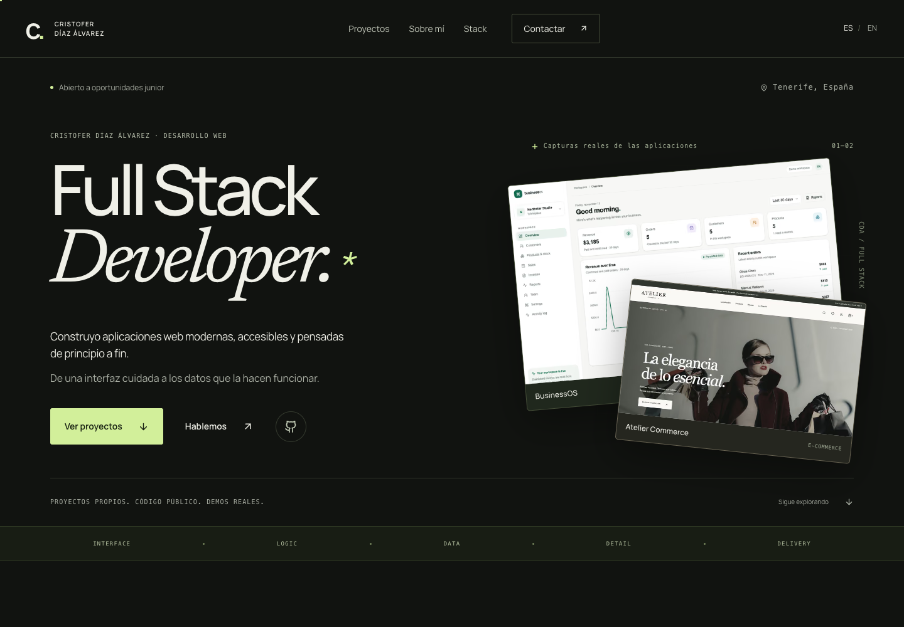
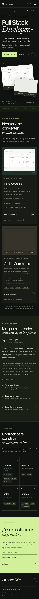

# Cristofer Díaz Álvarez · Developer portfolio

[](https://github.com/cristoferdiazalvarez/developer-portfolio/actions/workflows/ci.yml)

A bilingual personal portfolio for a Full Stack Developer based in Tenerife, Spain, seeking junior opportunities in Tenerife and remote work from Spain. Built around four published applications, their source code, architectural decisions and honest demo boundaries.



## Experience

- An original graphite, ivory and citrus editorial interface with self-hosted typography.
- Complete Spanish and English homes and case studies; switching languages preserves the selected project.
- Authentic screenshots of [BusinessOS](https://businessos-web-five.vercel.app), [Atelier Commerce](https://atelier-commerce-two.vercel.app) [FlowTeam](https://flowteam-ten.vercel.app) and [NEXORA](https://nexora-eta-steel.vercel.app), with links to source and live demos.
- Case studies explain problems, architecture, decisions, verifiable outcomes and limitations. Demo figures are fictional; no employment history or business metrics are invented.
- Keyboard skip link, native mobile dialog with focus handling, reduced motion support, semantic landmarks and responsive images.
- Localized metadata, generated Open Graph image, Person/CreativeWork structured data, robots and domain-aware sitemap/canonical URLs.
- No database, authentication, contact-form service or external runtime API.

GitHub and the owner-confirmed LinkedIn profile are available contact channels. Email and CV links remain hidden until the owner supplies confirmed public details or an authorized current file. Configure them in `lib/config.ts`; do not invent placeholders.

## Stack and architecture

Next.js App Router, React, strict TypeScript, Tailwind CSS 4, Motion and Lucide. Fonts are served locally through Fontsource. Vitest covers content/configuration contracts; Playwright and axe exercise the production build.

Two localized root layouts set the actual document language. Shared components render data from `lib/copy.ts` and `lib/projects.ts`. Next.js prerenders ten localized content pages (two homes and eight case-study routes); unmatched routes render localized 404s. [Architecture](docs/ARCHITECTURE.md) · [Asset provenance](docs/SOURCES.md).

## Run locally

Use Node.js 22.19 or newer within the Node 22 release line, and npm:

```sh
npm ci
cp .env.example .env.local
npm run dev
```

Open `http://localhost:3200`. No secrets or external service are required. `NEXT_PUBLIC_SITE_URL` can remain empty locally. On deployment, set it to the verified HTTPS origin and rebuild; this enables canonical/hreflang URLs, sitemap entries and absolute social URLs. No invented domain is embedded in production configuration.

```sh
npm run lint
npm run typecheck
npm test
NEXT_PUBLIC_SITE_URL=https://developer-portfolio-plum-mu.vercel.app npm run build
npx playwright install chrome
npm run test:e2e
npm run format:check
npm audit --audit-level=high
npm run security:scan
```

The publication scanner checks tracked files, so run it after `git add` when adding content. E2E starts the production server automatically and uses Chrome for desktop, tablet and emulated iPhone viewports. After starting `npm run start`, `npm run screenshots` captures real portfolio images into `docs/screenshots`.

## Validation

The FlowTeam review candidate passes 9 Vitest tests and 57 Playwright tests across desktop, tablet and mobile, including 24 automated accessibility/overflow checks across both languages and all eight content routes. Keyboard navigation, the three-case cycle, image loading, SEO and the original project links are covered. Automated axe checks support the WCAG 2.2 AA goal; they do not certify full conformance. See [verification](docs/VERIFICATION.md) and [progress](PROGRESS.md) for the final checks and limits.

<details>
<summary>Mobile screenshot</summary>



</details>

## FlowTeam review candidate

Branch `feat/add-flowteam` adds project **03**, a complete Spanish/English case study, cyclic three-project navigation, truthful polling/quota explanations, optimized production screenshots and dedicated FlowTeam Open Graph metadata. The original two project records and all their links/translations are unchanged. Five WebP assets total 222,906 bytes (about 218 KiB); no generated or stock replacement screenshots are used.

[FlowTeam case, desktop ES](docs/screenshots/flowteam-case-desktop-es.png) · [desktop EN](docs/screenshots/flowteam-case-desktop-en.png) · [mobile ES](docs/screenshots/flowteam-case-mobile-es.png) · [mobile EN](docs/screenshots/flowteam-case-mobile-en.png) · [tablet](docs/screenshots/flowteam-case-tablet.png)

**This candidate is for pull-request review. It has not been merged or deployed to production.** The public portfolio links below refer to the existing release, not this branch. The three linked application demos themselves are already published.

Asset import is reproducible with `node scripts/import-flowteam-assets.mjs`; it downloads only the documented FlowTeam production PNGs and encodes real pixels into WebP. [Review verification](docs/FLOWTEAM_REVIEW.md) · [Asset provenance](docs/flowteam-assets.json).

## Deployment status

Live on Vercel Hobby: [Spanish portfolio](https://developer-portfolio-plum-mu.vercel.app) · [English portfolio](https://developer-portfolio-plum-mu.vercel.app/en).

The existing November 13 release’s public HTTPS, all six content pages, localized navigation, mobile/desktop behavior and SEO configuration have been verified. The production browser suite passed all 26 tests. The account remains on the free Hobby plan; no paid service, card or billing activation was used. [Deployment details](docs/DEPLOYMENT.md) · [Public verification evidence](docs/public-verification.json).

The initial production release was deployed from tracked source through Vercel's REST API. The account has no GitHub integration, so repository pushes currently run CI without automatically redeploying production. See deployment documentation before releasing application changes.

## Project scope and rights

BusinessOS, Atelier Commerce and FlowTeam are independent projects and were not modified. FlowTeam screenshot derivatives come from its pinned public production captures, with source/output hashes in docs/flowteam-assets.json. Their infrastructure is separate. Third-party photographs visible inside Atelier screenshots retain their original rights; see [sources](docs/SOURCES.md). This repository does not grant a new license to those photographs or to personal identity assets.
